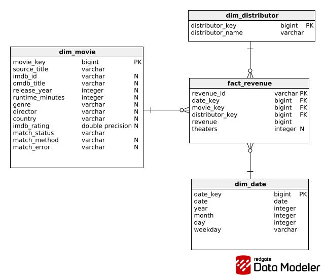

# Box Office Data Processing Pipeline

This project loads movie revenue data from the file `data/raw/revenues_per_day.csv`, enriches movie titles with data from OMDB, and stores the final data model to a DuckDB database.

Technologies used: Python, pandas, DuckDB, and Streamlit.

The goal was to keep the solution simple and avoid guessing in cases where a movie match is ambiguous.

## Data

The source file contains:
- 337818 revenue records
- 6545 unique movie titles

The date column is the date of revenue record, not the movie release year. Because of this I don't use the year from this column to match movies in OMDb.

Basic data analysis can be found in the following file: `notebooks/01_eda.ipynb`

## OMDb Matching

OMDb data is fetched once for every unique movie title.

The matching logic is simple:
1. First, I try the direct OMDb title lookup and accept it only if the returned title matches exactly.
2. If the direct lookup does not give an exact match, I use OMDb search.
3. If the search contains exactly one movie with the same title, I use this movie.
4. If the search contains multiple exact-title candidates, I flag the result as `needs_review`.
5. If no exact movie is found, I use `not_found`.

Fuzzy matching is not used, as the priority is to flag uncertain data rather than automatically selecting possibly wrong movie.

### OMDb fields

From the OMDb response I use:

- imdbID
- Title
- Year
- Runtime
- Genre
- Director
- Country
- imdbRating

Other fields are not needed for the current data model and ranking dashboard.

### Possible statuses are

* `matched` - movie was successfully matched with OMDb
* `not_found` - a query was sent to OMDb, but no exact movie was found
* `needs_review` - the result is ambiguous and requires manual checking
* `not_enriched` - film data has not yet been retrieved from OMDb

Titles where the gap between revenue records exceeds 365 days are also flagged.

This may indicate that different films share the same title or that the same movie was re-released. The processing pipeline does not try to guess which case it is.

## Cache

Responses from OMDb are cached in JSON. 

Since the free OMDb API has a daily request limit, previously retrieved movies are reused during subsequent pipeline runs.

The cache is also periodically saved, allowing the pipeline to continue even after the API limit is reached.

## Data Model

The target model is a simple star schema.

`fact_revenue` table contains records regarding daily revenue.

### Dimensions

* `dim_movie` - movie information and OMDb metadata
* `dim_date` - calendar information
* `dim_distributor` - film distributors

The grain of the `fact_revenue` table is a single daily revenue record from the source CSV file.

## Processing pipeline

The pipeline performs the following steps:
1. reads the `revenues_per_day.csv` file
2. fetches missing movie data from OMDb
3. reads movie information from the cache
4. flags ambiguous titles
5. transforms data from OMDb
6. creates dimensions and the fact table
7. loads the model into the DuckDB
8. creates a view displaying the movie ranking

Run pipeline: `python src/pipeline.py`

The OMDb API key must be saved in the `.env` file: `OMDB_API_KEY=your_key_here`

A sample `.env.example` file is included in the repository.

## Dashboard
The Streamlit dashboard displays a ranking of the top 20 movies by total revenue from the final data model.

Run dashboard: `streamlit run dashboard/app.py`